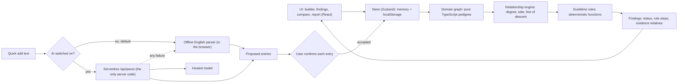

# KinTrace

Family history is the cheapest screening input medicine has, and the most under-used: most people do not know which relatives matter, or that a published guideline already says when a family pattern should lead to a referral. KinTrace lets anyone draw their family tree, pick one of those guidelines (NICE CG164 for breast and ovarian cancer, Amsterdam II for Lynch syndrome, NICE CG71, the Dutch Lipid Clinic Network family-history item and NICE NG238 for early heart disease and familial hypercholesterolaemia) and see which referral criteria the family meets, with the relatives behind each finding ringed on the tree. It never gives a risk figure or a diagnosis, everything stays on the device, and the output is a one-page report to take to a doctor.

Live site: https://kintrace-beta.vercel.app. Repository: https://github.com/SurabhiD2008/KinTrace.

| Home | Findings with evidence rings | One-page doctor report |
| --- | --- | --- |
|  |  |  |

## What it does

- **Build the tree** at `/build`: parents, siblings, half-siblings, partners, children, step and adoptive links, ages, deaths and conditions, with undo and redo. "Try the sample family" loads a ready-made tree.
- **Quick add**: type a few sentences (`My mum had breast cancer at 38`) and get proposed tree entries. Nothing is added until the user accepts each one. An offline English parser runs in the browser; an optional AI parser is used only when the user turns it on.
- **Findings** at `/findings`: for each guideline, Meets criteria, Worth discussing or No criteria met, with the exact rule steps and the relatives who triggered them, highlighted on the tree.
- **Compare guidelines** at `/compare`: the same family under every guideline side by side, with the threshold each one uses, so it is visible why they disagree (a father's heart attack at an age one guideline counts and another does not).
- **Doctor report** at `/report`: one printable page (A4 or US Letter), with an option to hide names, a plain-text copy and a JSON download.
- **What we do not know**: a completeness meter and a list of missing ages and unknown relatives.
- English, with Spanish and Hindi translations that still need a fluent review.

### The three hard rules

- **No risk percentages.** No probability, likelihood score or diagnosis is ever shown. A finding is only Meets criteria, Worth discussing or No criteria met, with its rule steps and its relatives.
- **Deterministic rules.** Every finding comes from a plain TypeScript function in `src/guidelines`. No model decides, ranks or words any finding.
- **AI only parses text, with consent.** The one AI feature turns free text into proposed tree entries. It is off until the user switches it on, the user confirms every entry, and an offline parser does the same job without it.

## Architecture



Everything left of the parser runs in the browser: the tree is a pure data structure, every change returns a new tree or a typed refusal, and the rules read it through the relationship engine, which counts only biological links and flags relatives reached through more than one line. The serverless function sees only the sentence the user typed and its language, validates every proposed entry against the shared schema, and drops any entry whose quote is not in the user's text; the browser falls back to the offline parser on any failure, within 9 seconds.

## Guidelines

<!-- guidelines:start -->
| Guideline | Publisher | Scope | Source | Rules last checked against the source |
| --- | --- | --- | --- | --- |
| Familial breast cancer: referral criteria (NICE CG164) | National Institute for Health and Care Excellence (NICE) | Published for England; only the family-history criteria are used here | [Familial breast cancer: classification, care and managing breast cancer and related risks in people with a family history of breast cancer](https://www.nice.org.uk/guidance/cg164/chapter/Recommendations) | 2026-11-11 |
| Lynch syndrome: Amsterdam II criteria | International Collaborative Group on HNPCC (Gastroenterology, 1999) | International | [New clinical criteria for hereditary nonpolyposis colorectal cancer (HNPCC, Lynch syndrome) proposed by the International Collaborative Group on HNPCC](https://pubmed.ncbi.nlm.nih.gov/10348829/) | 2026-11-11 |
| Familial hypercholesterolaemia: when to suspect it (NICE CG71) | National Institute for Health and Care Excellence (NICE) | Published for England; only the family-history criteria are used here | [Familial hypercholesterolaemia: identification and management](https://www.nice.org.uk/guidance/cg71/chapter/Recommendations) | 2026-11-11 |
| Dutch Lipid Clinic Network criteria: family-history item | European Atherosclerosis Society (European Heart Journal, 2013) | International | [Familial hypercholesterolaemia is underdiagnosed and undertreated in the general population: Consensus Statement of the European Atherosclerosis Society (Table 1)](https://pmc.ncbi.nlm.nih.gov/articles/PMC3844152/) | 2026-11-11 |
| Cardiovascular disease: family history to raise (NICE NG238) | National Institute for Health and Care Excellence (NICE) | Published for England; only the family-history criteria are used here | [Cardiovascular disease: risk assessment and reduction, including lipid modification](https://www.nice.org.uk/guidance/ng238/chapter/Recommendations) | 2026-11-11 |
<!-- guidelines:end -->

The table is generated from the guideline registry in `src/guidelines`; a unit test fails if the two disagree. The exact criteria implemented, the thresholds and what is left out are in [docs/RULES.md](docs/RULES.md), which changes before any rule does.

## How unknown data is handled

- Every test a rule applies to a relative answers passed, failed or unknown. A missing age or an unknown sex never counts as "not met": if completing it could satisfy a criterion, the finding is Worth discussing and names what is missing.
- Unknown is never treated as healthy. The rules count only what is recorded, never infer that a relative is unaffected, and the completeness meter counts missing ages, unknown relatives and missing parents.
- Adopted users with unknown birth parents are told that their biological history is unknown, rather than being asked to add their parents. Step and adoptive relatives are drawn on the tree but never counted as blood relatives.
- Self-reported conditions are labelled as such on the findings and the report. Parents who are blood relatives are flagged.

## Testing

<!-- tests:start -->
| Suite | Tests | What it covers |
| --- | --- | --- |
| Unit (domain, guidelines, parser, state, i18n, docs) | 759 | Vitest; pure functions, guideline rules at and either side of their age thresholds |
| Component | 134 | React Testing Library in jsdom; pages, dialogs, Quick add, the report |
| Property-based | 17 | fast-check, 500 generated families per property, fixed seed |
| Fuzz | 50 | hostile imports and hostile free text against the parser and the loader |
| Serverless function | 47 | the parse function with scripted providers: timeouts, 429, 500, bad JSON, invented quotes, injected instructions |
| Browser, Chromium | 91 | Playwright with the guard; every flow, edge cases, the guard self-test, the PDF page count |
| Browser, Firefox | 23 | the smoke, findings and report flows and the cross-browser edge tests |
| Browser, WebKit | 23 | the same set as Firefox |
| Browser, Chromium at 320, 390, 768, 1024, 1360 px | 130 | the main flows at each width (26 per width), in verify:final |

Unit-suite total: 1007. Line coverage 97.88% and branch coverage 91.28% over src/domain, src/guidelines and src/parser. Mutation score 78.4% (1377 of 1757 scored mutants killed, Stryker on the guideline rules and the relationship engine, run 2026-11-14).
<!-- tests:end -->

- One command, `npm run verify`, runs every check and prints PASS or FAIL for each: lint, types, unit tests with coverage thresholds (90% of lines and 85% of branches on the domain, guidelines and parser), build, browser tests, secret scan of the source, the build and the git history, dependency check, hygiene scan, documentation check (this README's numbers are produced or checked by it), bundle budget of 250 KB and the sample check. `npm run verify:final` adds three consecutive runs, the widths 320, 390, 768, 1024 and 1360, and a fresh-clone run.
- Every browser test runs under a guard that fails it on a console error, a failed request, horizontal overflow, clipped text, a tap target under 44 px, an accessibility violation (axe), layout shift, a missing language attribute or lost focus. The guard has a self-test proving each check fires.
- Age thresholds are tested at the limit and on either side of it. Property tests check that findings do not depend on the order people were added, that saving then loading returns the same tree, that adding an affected relative never lowers a status and that removing a triggering relative never raises one.
- Testing found 16 bugs, each fixed with a test that failed first: silent data loss on save, two tabs overwriting each other, the report dated the wrong day in some time zones, an AI answer writing an unknown condition into the tree, and the deployed parse function failing to load on Vercel, which only the production smoke check caught. They are written up in [docs/BUGS_FOUND.md](docs/BUGS_FOUND.md).

## Privacy and security

- **No server storage.** The family tree lives in the browser's memory and `localStorage`, and "Clear everything" removes it. There is no database, no account and no analytics.
- **Network audit.** A browser test runs the whole flow (build, Quick add, import, export, findings, compare, report, language switch) with AI off and asserts that not one request leaves the app's own origin. With AI on, the only extra request is the same-origin `/api/parse`, and its body holds only the typed text and the language: no tree, no names, no ids. Fonts are bundled.
- **Headers.** `vercel.json` sets a strict Content-Security-Policy (`default-src 'self'`, no inline scripts, no `unsafe-eval`, `frame-ancestors 'none'`), `X-Content-Type-Options: nosniff`, `Referrer-Policy: no-referrer` and a Permissions-Policy that turns off camera, microphone and location. The preview server sends the same headers, so every browser test runs under the real policy.
- **The parse function** logs only codes, counts and timings, never the text or the answer. It is rate-limited to 6 requests per 10 minutes per address, 4 model calls at once and 300 calls a day per provider, has a timeout of 8 seconds per model call, validates input with a schema and treats the user's text as data, not instructions. Keys are read from environment variables only; the secret scan checks the source, the build and the whole git history for them.

## How to run

Requires Node 22 or newer.

```bash
npm ci
npx playwright install chromium firefox webkit
npm run dev
```

The app needs no configuration and no key: Quick add uses the offline parser, and "Try the sample family" gives a full demo. `npm run dev` does not serve `/api`; to try the AI parser locally, copy `.env.example` to `.env`, add a key and run `vercel dev`.

| Command | What it does |
| --- | --- |
| `npm run dev` | Vite dev server. |
| `npm run build` | Production build into `dist/`. |
| `npm run verify` | Every check, PASS or FAIL each; also `npm run test:all`. |
| `npm run verify:final` | `verify` plus three consecutive runs, five widths and a fresh-clone run. |
| `npm run test` | Unit, component, property and fuzz tests with coverage. |
| `npm run test:e2e` | Browser tests with the guard against the production build (also `npm run e2e`). `E2E_BROWSERS=chromium,webkit` runs a subset. |
| `npm run test:prod` | The builder, findings, report and network-audit browser tests against a deployed site named by `BASE_URL`. |
| `npm run smoke` | `npm run smoke -- <url> [--full] [--static]`: health, page, asset and API checks against a running instance. |
| `npm run test:mutation` | Stryker on the guideline rules and the relationship engine; updates `docs/mutation-score.json`. |
| `npm run check:providers` | One tiny real call per AI provider (costs money; never part of `verify`). |
| `npm run eval:parser` | The parser evaluation set; with a key, also through the real AI parser (costs money). |
| `npm run screenshots` | Refreshes the pictures in `media/`. |
| `npm run typecheck`, `npm run lint` | Strict type check; ESLint with no warnings allowed. |

### Environment variables

Read only by the serverless parser, through `api/_lib/config.ts`, which stops the function with a message naming any invalid variable. The browser bundle never sees them.

| Variable | Required | Meaning |
| --- | --- | --- |
| `NVIDIA_API_KEY` | Only for the AI parser | NVIDIA API key from build.nvidia.com. Without it the function answers "unavailable" and the browser uses the offline parser. |
| `PARSER_MODEL` | No | Model identifier from NVIDIA's catalogue; the default is in `api/_lib/config.ts`. |
| `PARSER_PROVIDERS` | No | Providers to try, in order, separated by commas; default `nvidia`. |
| `PARSER_DAILY_CAP` | No | Most model calls per provider per day, per instance; default 300 calls a day. |

### Deploy

The project deploys to Vercel as configured in `vercel.json`: the static site from `dist/` plus the one function in `api/parse.ts`.

```bash
npx vercel login
npx vercel link
npx vercel env add NVIDIA_API_KEY production
npx vercel --prod
```

Then check the live site:

```bash
npm run smoke -- https://kintrace-beta.vercel.app --full
```

```bash
BASE_URL=https://kintrace-beta.vercel.app npm run test:prod
```

## Limitations and caveats

- **Not a medical device.** KinTrace does not diagnose, estimate risk or replace a clinician or genetic counsellor. It shows which published referral criteria a family history meets, as entered by the user.
- **Guideline sources are from the UK, the Netherlands and international groups.** Local guidance may differ, and a clinician may apply criteria this app does not implement. Rules see relatives up to third degree only; CG164 recommendation 1.3.4 and the specialist-clinic criteria in 1.4.4 are not implemented. The Amsterdam II text was read from the NCI summary, not the original paper.
- **Translations.** The Spanish and Hindi strings need a review by fluent speakers before release.
- **The offline parser reads English only.** The AI parser is less accurate than the offline one and relies on the user checking each suggestion.
- The parser's rate limits live in memory, per serverless instance: they reset when an instance restarts and are not shared between instances.
- A tree holds at most 500 people; an import over 2 MB is refused; Quick add reads at most 2000 characters and shows at most 100 suggestions. Ages are whole years, up to 120.
- Firefox browser tests run in CI only: the Firefox build Playwright installs does not start on the development machine.
- Pinch-to-zoom is not implemented; the zoom buttons and dragging work. Several files are over the size limits; each is listed with its reason in [verify.allowlist.json](verify.allowlist.json).

## Roadmap

- **Other conditions**: familial colorectal cancer beyond Lynch syndrome, inherited cardiomyopathy and sudden cardiac death in the young, and prostate and pancreatic cancer in families with breast and ovarian cancer.
- **More guidelines**: national referral criteria from other countries alongside the current ones, so users can pick the guidance their own health system uses, each added to `docs/RULES.md` with its source before its rule is written.
- **More languages**, each reviewed by fluent speakers, and an offline parser for each.
